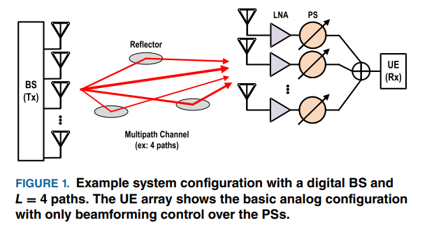
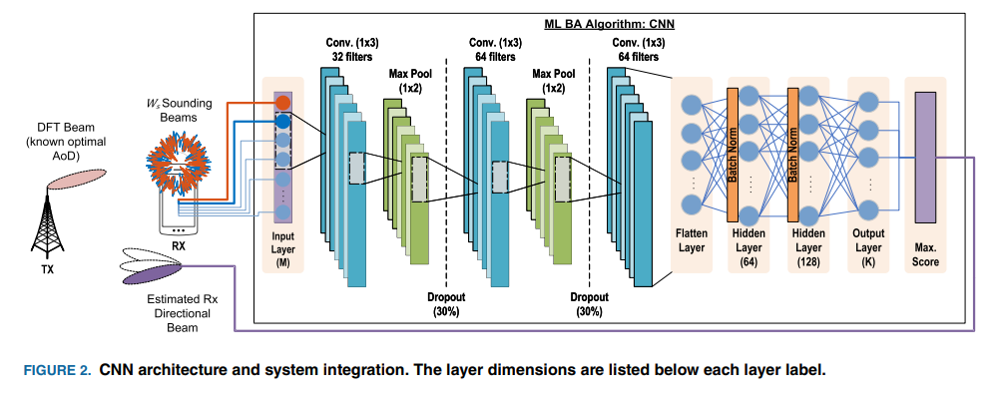
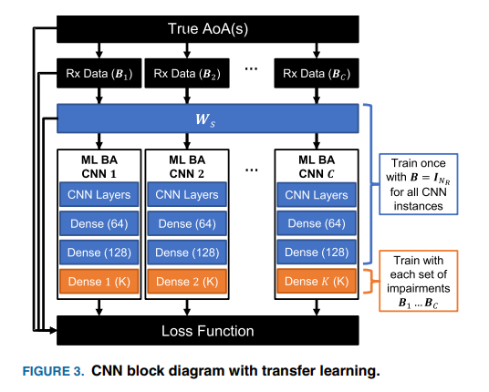
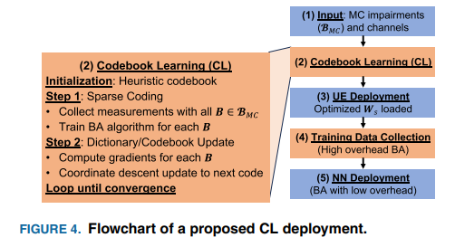
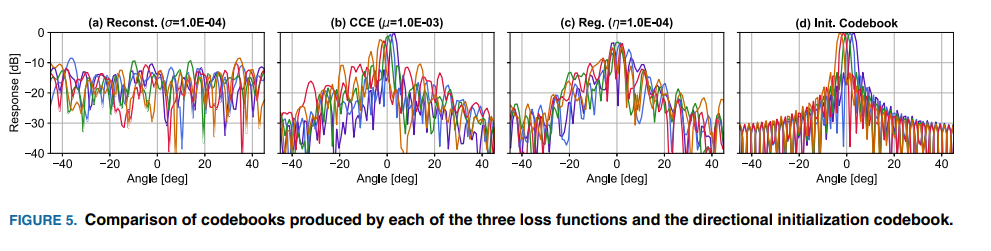
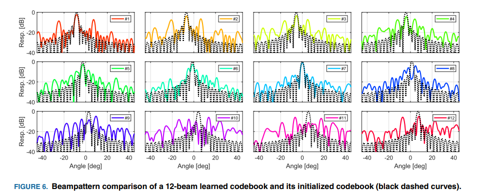
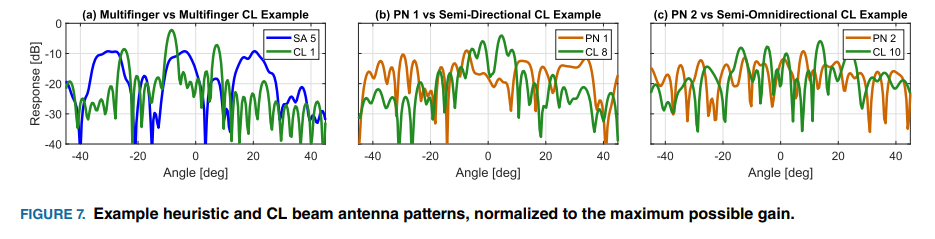
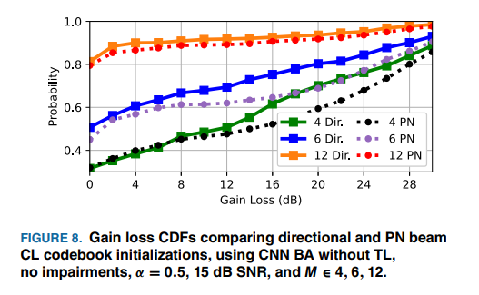
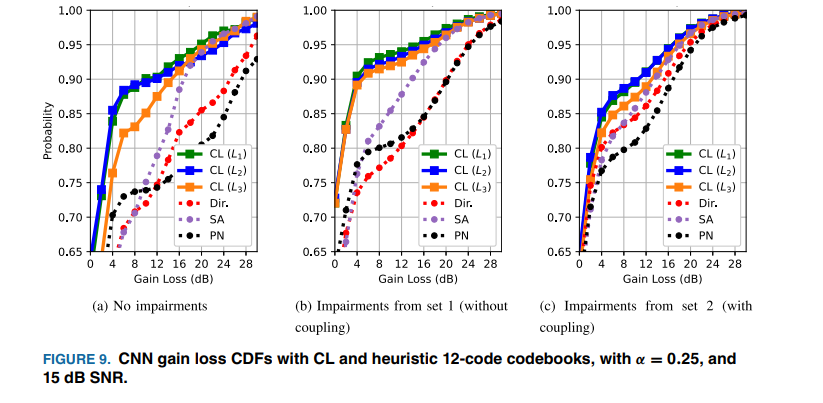
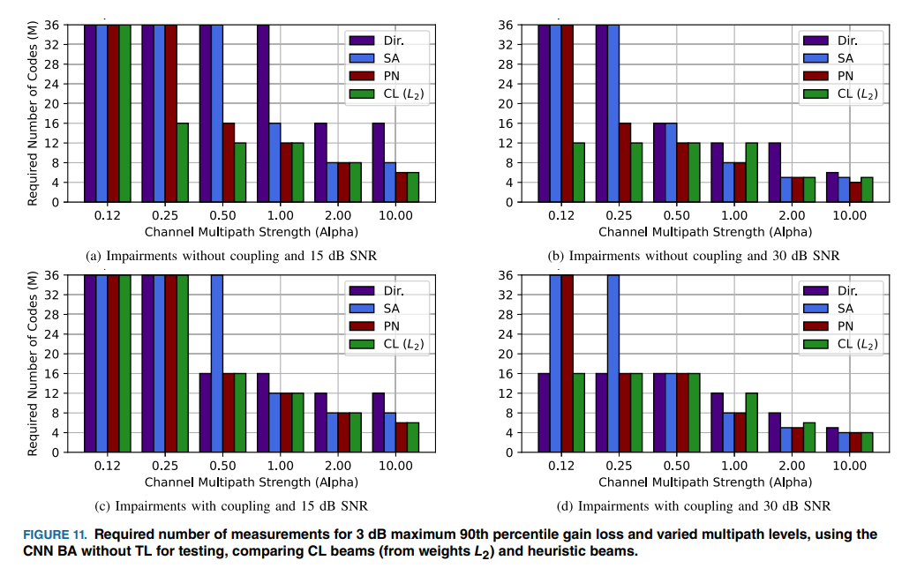

# Dictionary Learning Method for Phase-Coded Beamforming Codebook Design in Multipath Channels[with Python code]

Multipath Channels: Design of Dictionary Learning Approach for Unphased Beam Alignment Codebook
Abstract: In wireless networks operating in millimeter-wave and Asia-Pacific Hertz bands, large antenna arrays are key to ensuring communication reliability and achieving high-rate transmission. The initial beam alignment method using traditional analog phased arrays has an overhead that linearly scales with the array size, whereas compression sensing and machine learning algorithms can achieve logarithmic growth. However, these algorithms often employ pseudorandom or heuristic beam designs as their codebooks, which are not optimal in scenarios where array damage is uncertain, multipath effects are present, especially when only unphased or power-based measurement values are available.
This paper proposes a novel dictionary learning approach tailored for multipath channels and unknown statistical damage characteristics, designed for unphased beam alignment. This codebook learning algorithm updates the codebook through alternating optimization using block coordinate descent, incorporating Monte Carlo experiments for multipath and damage scenarios, along with prior knowledge from hardware and environment. Additionally, this paper explores engineering considerations for the codebook design algorithm, compares three loss functions and three beam alignment algorithms for codebook learning, and suggests applying transfer learning to machine learning-based beam alignment to reduce training time for machine learning models and codebook learning. Experiments demonstrate that the proposed codebook learning approach and machine learning-based beam alignment algorithm significantly reduce the number of measurements required for beam alignment, lowering alignment overhead.
Introduction: Currently and future cellular network planning work in the 30-300GHz millimeter-wave and Asia-Pacific Hertz bands aims to support ultra-high data rate transmission. This band's significant bandwidth availability is crucial for wireless communications. Due to the characteristics of radio waves in this frequency band—high free space path loss and weak multipath effects—electronic beam shaping capabilities of large antenna arrays become essential for maintaining sufficient signal-to-noise ratio.
Key Challenges for Millimeter Wave and Asia-Pacific Hertz Communication Systems include the high latency and high overhead issues during initial user equipment (UE) connection with base stations. While digital antenna arrays and hybrid arrays can determine beam direction with minimal latency, their practicality is limited by hardware, power consumption, and cost constraints; analog phased arrays are the mainstream deployment solution for millimeter wave UEs, but they require sequential beam measurement channels to determine beam direction, which results in significant latency and overhead. However, due to the sparseness of channel angles in this frequency band, the compression method selected by the beamformer offers feasibility.
This article proposes four additional considerations to make the problems of millimeter-wave beam alignment and codebook design more challenging and difficult to solve, based on practical system constraints: First, the user device can only acquire measurement values for phase, power, or received signal strength, which also enhances the compatibility of the algorithm with existing millimeter-wave standards and hardware. Second, a fixed codebook is designed for channel perception in the angular domain for beam alignment, avoiding extra computations and complex hardware requirements between measurements. Third, data communication for the user device also needs to use a fixed codebook, and by designing different codebooks for beam alignment and data communication, rapid channel perception can be achieved without losing directional gain. Fourth, the designed beam alignment algorithm and codebook must be robust against random array damage, caused by hardware defects, manufacturing differences, and hardware aging, and the codebook must adapt to all user devices, requiring pre-deployment handling of unknown damages.
The multipath channel, combined with the four considerations mentioned above, makes beam alignment a challenging problem to solve analytically. The lack of phase measurement, the selection of only the strongest directive wave beam, and unknown damage introduce nonlinearity and additional randomness. Existing research has only explored parts of this issue individually. Therefore, this paper aims to seek a systematic method for codebook design in the context of mm-wave beam alignment under the constraints mentioned above.
Method Introduction: This paper proposes the **Codebook Learning (CL)** framework, applying dictionary learning to optimize fixed codebooks for phased array beam steering without phase shift. The core revolves around four major modules: system modeling, beam steering algorithm design, dictionary learning reconstruction and codebook update, and loss function design. Key methods and technologies are as follows:
1  
System Modeling: A user equipment analog phased array system model containing 36 elements was constructed. Perception codebook and data communication directional codebook were defined. A geometrically attenuated multipath channel model was used to simulate a 2-dimensional millimeter wave channel. The mutual coupling, gain, and phase mismatch between antenna elements were modeled through the coupling matrix. The measurement model for the unphased received signal strength and the core objective of beam alignment - selecting the optimal directional communication beam were clarified.
2  
Three Beam Positioning Algorithms: Three beam positioning algorithms suitable for codebook learning were designed and compared. These include the RSS-MP algorithm based on Compressed Sensing Matching Pursuit (CSMP), a machine learning-assisted beam positioning algorithm using Convolutional Neural Networks (CNN), and the proposed transfer learning version of CNN (CNN-TL). The CNN-TL reduces the average training time by 42% by pretraining the base model to fix most layer parameters and only training the final fully connected layer, making it a key to efficient codebook learning.
3  
Dictionary learning re-construction for codebook learning: Improves traditional dictionary learning to adapt to the nonlinear characteristics of phase-free beam alignment. Adopts an alternating optimization strategy with block coordinate descent to implement codebook updates: First, completes sparse coding through beam alignment algorithms, then updates the individual beam weights of the sensed codebook based on analytical gradients; combining Monte Carlo experiments, averages loss across various instances of multipath channels and array damage, designing a robust fixed codebook. It also determines that directional beams are the optimal choice for initializing the codebook, offering superior beam alignment performance compared to pseudorandom beam initialization.
4  
Multi-loss function design and fusion: Three loss functions suitable for codebook learning are proposed, including reconstruction error loss, classification cross-entropy (CCE) loss, and coherence regularization loss. By weighted fusion of these three losses (optimal combination being CCE loss + coherence regularization loss), the problem of gradient quantization and high codebook correlation is addressed. Additionally, considering only phase-only updates for phase control constraints in analog phased arrays, and incorporating gradient compensation based on measurement scaling to adapt to the input requirements of machine learning algorithms.
Algorithm deployment process: Codebook learning is completed before device deployment, based on factory manufacturing statistics and channel statistical data to simulate Monte Carlo training data, resulting in a fixed perception codebook pre-installed on all devices. After device deployment, two-stage CNN training is conducted: first, collect measurement data from both perception and directional codebooks, then train a dedicated beam alignment model, with subsequent beam alignment achieved solely through a small amount of measurement data from the perception codebook.
Conclusion: This paper proposes a novel algorithm for unknown damage scenarios and fixed codebook design for phase-free beam alignment—codebook learning. Based on compression sensing dictionary learning, the algorithm employs alternating optimization via block coordinate descent, designs beam weights using simulated data, and integrates the performance of the compression beam alignment algorithm into codebook design through system model gradient backpropagation. It is particularly suitable for machine learning-assisted beam alignment methods.
Optimization training criteria for codebook learning are provided: Training with strong multipath channels and high signal-to-noise ratio data to initialize the codebook; simulation experiments comparing the performance of initializing the codebook, beam alignment algorithms, and loss function combinations demonstrate that, in most scenarios, the designed codebook by codebook learning can enhance the gain loss performance of beam alignment, reducing measurement overhead under strong multipath channels and unknown array damage.
Future research can further optimize the codebook learning algorithm, enhancing its transfer learning performance and robustness in codebook initialization. Additionally, this method can be extended to more complex antenna array geometry structures, addressing issues with heuristic beamforming design in such scenarios.

## Images

<!-- PAYMENT_BLOCK -->

## Get this dataset

- Payment link (Stripe): [Buy now](https://buy.stripe.com/3cs8yP7sY87d0vu9AB)
- Payment QR code: 

<!-- /PAYMENT_BLOCK -->
